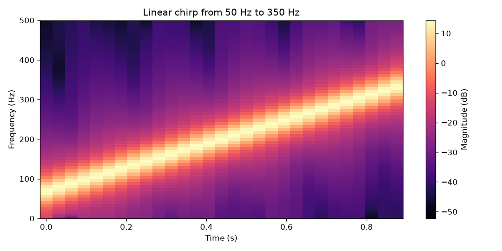
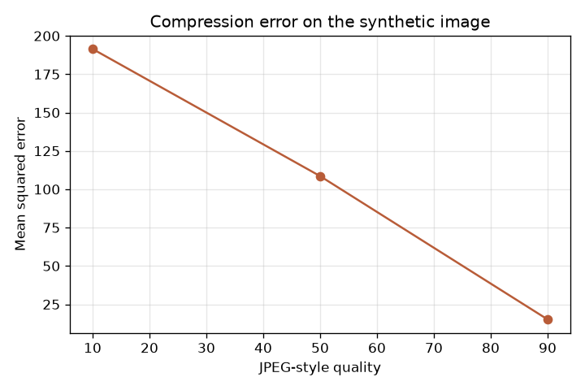
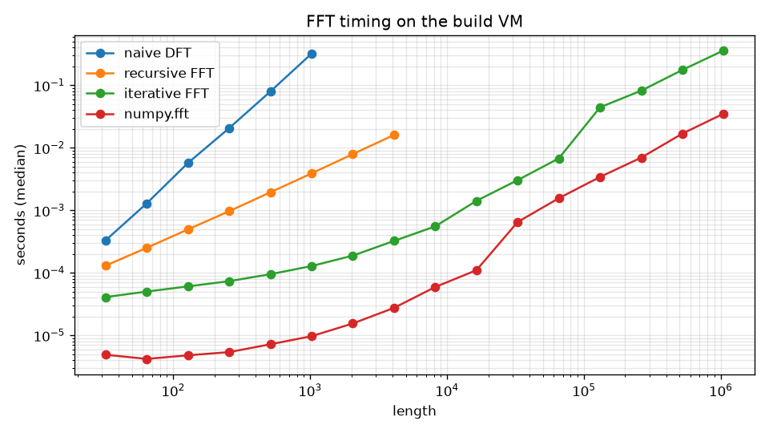
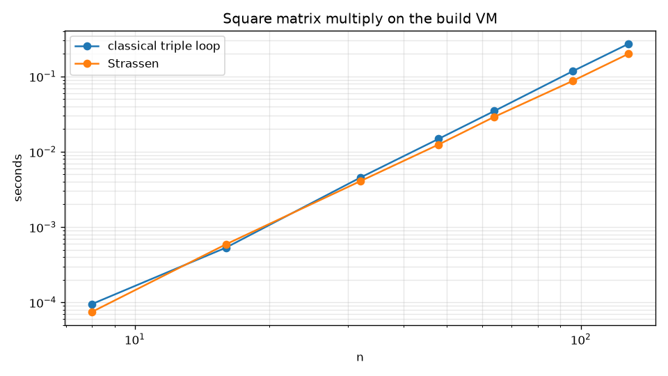
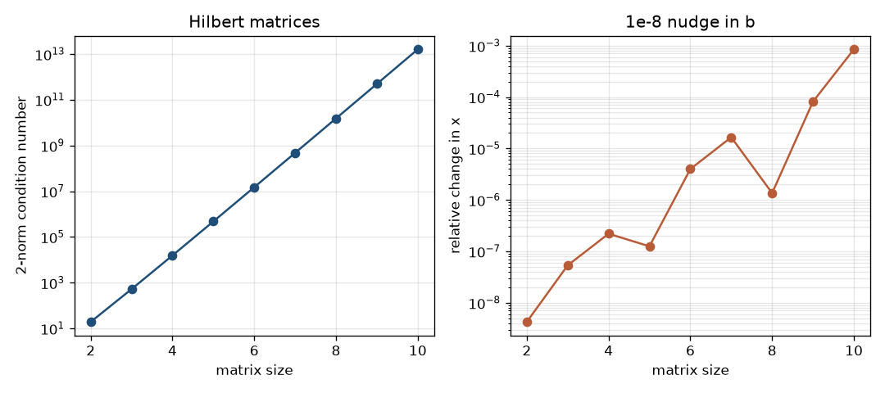

# Chapter 11 report: FFTAnalyzer

Word count: 1493 words, not counting this line or the title.

## Executive summary

FFTAnalyzer is my Week 12 package for the matrix routines and fast transforms in Chapter 11. I wrote the algorithms. NumPy stores the arrays, and the tests use np.fft and np.linalg only as a check.

The iterative Cooley-Tukey FFT does each butterfly stage as one NumPy operation on the whole block. On my PC, length 2^20 took 0.361 seconds. NumPy's fft took 0.0352 seconds on that same array. The direct DFT at length 1024 took 0.320 seconds. Condition numbers for the Hilbert matrices go from about 19 at n = 2 to 1.60e13 at n = 10. The CSV and plots are in benchmarks/results.

## Numerical algorithm theory

Amakobe (2026, section 11.5) starts from the triple loop, O(n^3) for a square matrix, then Strassen's split: 2 by 2 blocks with seven products instead of eight. That recurrence is O(n^log2(7)), about O(n^2.807). The same section says the extra additions and the weaker rounding are why libraries usually skip it. I implemented it anyway, with the triple loop as the leaf at 16 by 16, so those sizes do not split. On my PC the plain loop is faster at n = 16, 0.000532 seconds against 0.000589. From n = 32 up, Strassen is faster.

LU with partial pivoting writes PA = LU. The largest remaining column entry becomes the pivot. The determinant is the swap sign times the product of the U diagonal. A zero pivot returns 0, and solve raises. Substitution finishes the triangular systems, and the inverse is one solve per identity column. QR is Householder, so A = QR with Q orthogonal. The power method uses the triple loop for each matrix-vector product and stops on the Rayleigh quotient. On the matrix with 2s on the diagonal and 1s off it, the value is 3.

Section 11.6 is the floating-point part. I measure absolute and relative error and the 1, 2, and infinity norms. The matrix 2-norm is the square root of the dominant eigenvalue of A transpose A. The condition number multiplies a norm by the norm of the inverse. I flag ill-conditioning at 1e6. The Hilbert matrix, the chapter's example, crosses that line by n = 6.

## FFT and spectral analysis

Section 11.2 writes the DFT as a sum of x_n exp(-2 pi i k n / N). The direct sum is O(N^2). Section 11.3 splits even and odd indexes, the Cooley-Tukey step, and the Master Theorem gives O(N log N). I coded the recursive form and the iterative form that starts in bit-reversed order. For length 8 that order is 0, 4, 2, 6, 1, 5, 3, 7. The inverse is conj(FFT(conj(X))) / N.

Circular convolution multiplies FFTs and needs a shared power-of-two length, since padding would change the period. Linear convolution pads to the next power of two and keeps len(a) + len(b) - 1 samples. Polynomial multiplication is that convolution (section 11.4). Autocorrelation is ifft of the squared FFT magnitude.

Filters are brick-wall masks: low-pass, high-pass, and band-pass. Hann, Hamming, and Blackman are the cosine windows. The periodogram windows the signal and scales the squared magnitude by the sample rate times the window energy. The spectrogram is a short-time FFT.

A 60 Hz tone plus 180 Hz, sampled at 1024 Hz, peaked on those two bins, with 60 Hz taller. The chirp from 50 Hz to 350 Hz is the ridge below. A sine of period 12 came back with dominant lag 12. That series is synthetic.

## Image and audio results

The 2D FFT runs the 1D iterative transform on rows, then on columns. Gaussian blur multiplies by exp(-2 pi^2 sigma^2 (fx^2 + fy^2)). Sobel and Laplacian use zero-padded FFT convolution. Denoising keeps a disk of low frequencies.

The demo image is 128 by 128, drawn in code: a ramp, a slow sine, a rectangle, a disk, then noise. Sobel magnitude pulls out the outlines.

Compression is an orthonormal DCT-II on 8 by 8 blocks and the JPEG luminance table. Below quality 50 the scale is 5000/quality. From 50 up it is 200 minus 2 times the quality. Entries stay in 1 through 255, so quality 100 still rounds. Mean squared error on the noisy demo was 191.45 at quality 10, 108.56 at quality 50, and 15.12 at quality 90. Quality 10 is blocky.

Hard low-pass denoising made this picture worse. Error against the clean drawing was 142.92 with the noise left in, and 162.23 after the cutoff. The rectangle and the disk are sharp, so the cutoff hurts edges more than it removes noise. On a smooth sine in the tests, the same cutoff does lower the error.

Audio is 16-bit mono WAV through the wave module. The demo is one second at 4096 Hz: 220, 277, 330, and 1800 Hz, plus a little white noise. Energy was 1080 before filtering, 890 after a 600 Hz low-pass, and 888 after a band-pass from 200 to 400 Hz. The spectrogram shows those four lines.

## Stability considerations

Section 11.6 shows up in two checks. (1e16 + 1) - 1e16 comes back as 0, because 1 is not representable next to 1e16. Summing 1e16, then 1, then -1e16 is also 0, and Kahan does not rescue it. The correction bit has the same problem. Kahan does help on tenths: 100,000 copies of 0.1 should total 10,000. The compensated sum hits 10,000. The plain running total does not.

For x^2 + 1e8 x + 1 = 0 the schoolbook quadratic cancels on the tiny root. I compute the root that does not cancel, then recover the other from the product of the roots. The stable error on that tiny root is smaller, and the test checks it.

A nudge of size 1e-8 in b, one fixed random direction, moves the Hilbert solution by 4.23e-9 at n = 2 and by 8.47e-4 at n = 10. The path dips. At n = 8 the relative change is 1.35e-6 after 1.65e-5 at n = 7. The condition number does not dip: about 1.53e10 at n = 8 and 1.60e13 at n = 10. That plot is one noise direction, so I do not expect the change to equal kappa times the nudge. Pivoted LU still factors these matrices through n = 10. The identity has condition number 1, and the same nudge barely moves x.

## Benchmarking plots

Times below are medians from benchmarks/run_benchmarks.py on my PC: Python 3.14.7, Windows 11, AMD64, 12 CPUs. The CSV is benchmarks/results/benchmarks.csv. Naive and recursive runs use 3 repeats, except one naive run at length 1024. Iterative FFT and np.fft use 5 repeats under 2^14, then 3, then one run from 2^18 up. Matrix products use 5 repeats through n = 64 and 3 after that. Figure titles still say build VM from that old hardcoded string. The CSV is this machine.

At length 1024 the naive DFT took 0.320 seconds, the recursive FFT 0.00389 seconds, the iterative FFT 0.000128 seconds, and np.fft 0.0000097 seconds. That is about 2,490 times between the double loop and the iterative transform. At length 4096 the recursive form took 0.0160 seconds and the iterative form took 0.000324 seconds. At 2^20 the iterative FFT took 0.361 seconds and np.fft took 0.0352 seconds, about 10.3 times apart.

From n = 64 to n = 128 the classical time went from 0.0348 seconds to 0.271 seconds, a factor of 7.81. An n cubed algorithm predicts 8 when n doubles, so this is close. Strassen went from 0.0291 seconds to 0.200 seconds, a factor of about 6.88. log2(7) is about 2.807, so a doubling should cost about 7.0 if the recurrence dominated. At n = 128 Strassen was about 1.36 times faster. At n = 16 the classical loop wins, because that size is the leaf and Strassen does not split.

## Final reflections

The FFT is cheap enough to live inside ordinary audio and image code (Amakobe, 2026, sections 11.1 and 11.7). The recursive form is the one I can walk by hand. The iterative form is the one that finishes a million samples. A frequency product is convolution, polynomial multiplication, and the autocorrelation on the lag-12 series.

The triple loop scaled by about 7.8 when n doubled, close to the factor of 8 from n cubed. Strassen was faster from n = 32 up and slower at the n = 16 leaf. I trust the condition number more than a tiny residual, because a Hilbert solve can look fine on Ax - b and still jump when b moves by 1e-8.

The tests check the FFT against np.fft, including a length 2^20 round trip, plus convolution, LU and QR reconstruction, the filters, compression error falling as quality rises, and the stability checks. Examples write a synthetic WAV, a drawn image, and the plots under outputs/. Nothing is downloaded.

## Reference

Amakobe, M. (2026). *Advanced computational algorithms* (2nd ed.).
